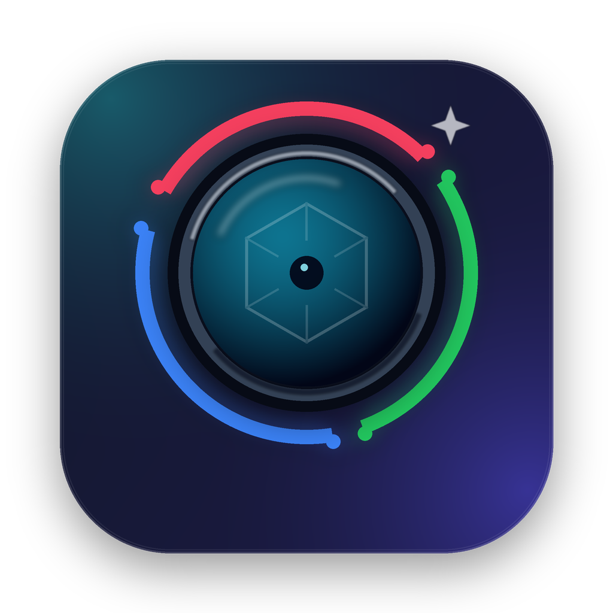

<p align="center">
  
</p>

# Camera Tuner

<p align="center">
  <a href="LICENSE"></a>
  <a href="https://ko-fi.com/nuetasw"></a>
</p>

A native macOS SwiftUI app for tuning USB cameras. It combines:

- **Hardware UVC controls** — brightness, contrast, saturation, hue, gain, gamma, sharpness, white balance, exposure, focus, zoom, backlight, and power-line frequency. These are sent straight to the camera over USB, so they also apply in Google Meet, Zoom, OBS, QuickTime, etc.
- **Software look controls** — RGB gain, brightness, contrast, saturation, gamma, temperature, tint, and mirror. These are applied live to CameraTuner's preview with Core Image + Metal.
- **Presets** — save the current hardware values and software look as a named preset, then apply it manually or star it to auto-apply per camera on launch/reconnect.

## Requirements

- macOS 14 or later
- Xcode 15+ for the Xcode project, or just Command Line Tools for `scripts/build.sh`
- An external **UVC** camera for hardware controls. Built-in, Continuity, and some vendor-specific cameras do not expose standard UVC controls.
- Python 3 + Pillow only if you want to regenerate the app icon

## Build

### Xcode

Open `CameraTuner.xcodeproj`, select the **CameraTuner** scheme, and run.

The app is intentionally **not sandboxed** so it can open the USB device through IOKit. Camera access is requested on first launch; `NSCameraUsageDescription` is in `CameraTuner/Info.plist`.

### Command line

```bash
./scripts/build.sh          # builds build/Camera Tuner.app
./scripts/build.sh --run    # builds and opens it
```

### Install with make

```bash
make install
```

This builds the app and copies it to `~/Applications` without sudo. To install system-wide:

```bash
make install INSTALL_DIR=/Applications
```

Remove it again with:

```bash
make uninstall
```

Other targets: `make build`, `make run`, `make reinstall`, `make icon`, `make clean`, and `make help`.

### Regenerate the app icon

```bash
python3 scripts/make_icon.py
```

This writes `CameraTuner/Resources/AppIcon-1024.png` and `CameraTuner/Resources/AppIcon.icns`.

## Usage

1. Launch Camera Tuner and allow camera access when macOS asks.
2. Pick a camera from the picker in the top-right.
3. Open the **Camera** tab for hardware controls. These changes are written to the camera and should be visible in other apps.
4. Open the **Look** tab to tune the software preview. This does not change the camera stream seen by other apps.
5. Open the **Presets** tab to save, apply, star, or delete presets.

### Camera tab

- Sliders read the camera's current value, minimum, maximum, and default.
- **Auto** switches appear when the camera exposes the matching auto control.
- Moving a manual slider while auto is on first switches the camera to manual.
- **Reset Camera Defaults** restores the camera's factory defaults.
- **Read current camera values** refreshes values changed outside the app.

### Look tab

- **Enable software adjustments** toggles all software effects on/off.
- Light: brightness, contrast, gamma.
- Color: saturation, temperature, tint, red, green, blue.
- Geometry: mirror preview.
- **Reset Look** restores the neutral look.

These changes only affect CameraTuner's preview. To use them in Google Meet, use the hardware controls or a virtual camera such as OBS's virtual camera.

### Presets tab

- Enter a name and click **Save Preset** to save the current hardware + look setup.
- Click a preset row to apply it immediately.
- Click the star to auto-apply that preset for the current camera. Click it again to disable auto-apply.
- The first preset saved for a camera becomes its auto-apply default.
- Auto-apply runs on app launch, camera selection, and reconnect. Manual **Refresh Cameras** / **Reload UVC controls** actions do not overwrite unsaved changes.
- Presets are stored per camera model in `UserDefaults` and survive relaunches.

## Google Meet / Zoom

- **Camera** tab changes should be visible in Google Meet, Zoom, and other apps because they are applied to the UVC hardware.
- **Look** tab changes are preview-only. Google Meet reads the physical camera directly and never sees CameraTuner's filtered frames.
- A future virtual-camera extension would make the **Look** adjustments available to Meet. Until then, OBS Virtual Camera is the simplest workaround.

## Troubleshooting

- **No camera in the picker** — check System Settings → Privacy & Security → Camera, then refresh. You can also reconnect the USB camera.
- **No UVC controls** — the selected camera may be built-in, Continuity, or expose only vendor-specific controls. Standard UVC Camera Terminal / Processing Unit controls are supported.
- **Hardware sliders do nothing in another app** — the other app may reset the camera's auto controls. Set the matching **Auto** switch off in CameraTuner and try again.
- **Look changes do not show in Google Meet** — expected; see the Google Meet section above.
- **App icon looks stale in Finder** — run `touch "build/Camera Tuner.app"` or restart Finder.

## How it works

- `AVCaptureDevice.DiscoverySession` enumerates cameras and `AVCaptureVideoDataOutput` drives the preview.
- `UVCDevice` finds the camera's `IOUSBDevice`, parses the VideoControl interface descriptors to locate the Camera Terminal and Processing Unit, then sends UVC class requests (`GET_CUR`, `GET_MIN`, `GET_MAX`, `GET_DEF`, `SET_CUR`) on endpoint 0 through the legacy `IOUSBLib` interfaces. Writing on the device (rather than seizing the VideoControl interface) lets the preview use AVFoundation at the same time.
- Preview frames are converted to `CIImage`, filtered with `CIColorMatrix`, `CIColorControls`, `CIGammaAdjust`, and `CITemperatureAndTint`, then rendered into an `MTKView` with aspect-fit letterboxing.

## Project layout

```text
CameraTuner/
├── CameraTuner/
│   ├── App/          app entry point, model, settings, preset storage
│   ├── Capture/      AVFoundation + Core Image + Metal preview
│   ├── UVC/          UVC descriptors, IOKit device access, controls
│   ├── Views/        SwiftUI interface
│   └── Resources/    app icon
├── CameraTuner.xcodeproj
├── .github/FUNDING.yml
├── scripts/
│   ├── build.sh
│   └── make_icon.py
├── Makefile
├── LICENSE
└── README.md
```

## Support

If Camera Tuner is useful to you, you can support development on Ko-fi:

[Support Camera Tuner on Ko-fi](https://ko-fi.com/nuetasw)

## License

Released under the [MIT License](LICENSE).

## Notes and limitations

- Only standard UVC Camera Terminal / Processing Unit controls are supported. Vendor-specific extension units (for example, some Logitech or Razer features) are not.
- Some cameras report invalid min/max ranges. CameraTuner falls back to a sensible range in that case.
- Hardware settings are stored in the camera and may be reset when the camera is unplugged.
- Software adjustments are preview-only in this version; no recording or virtual-camera output is included.
- The app is ad-hoc signed by `scripts/build.sh`. The first launch on another Mac may require right-click → Open.
